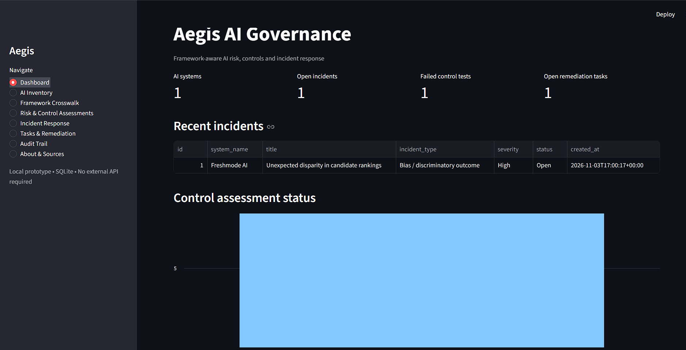
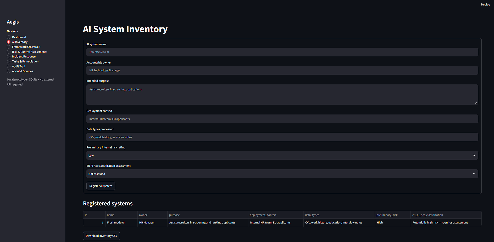
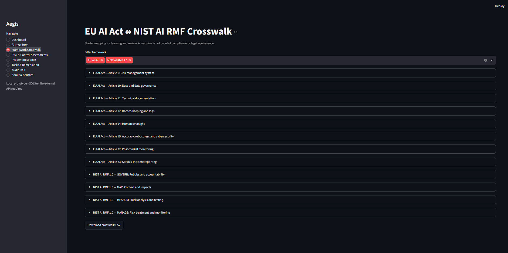
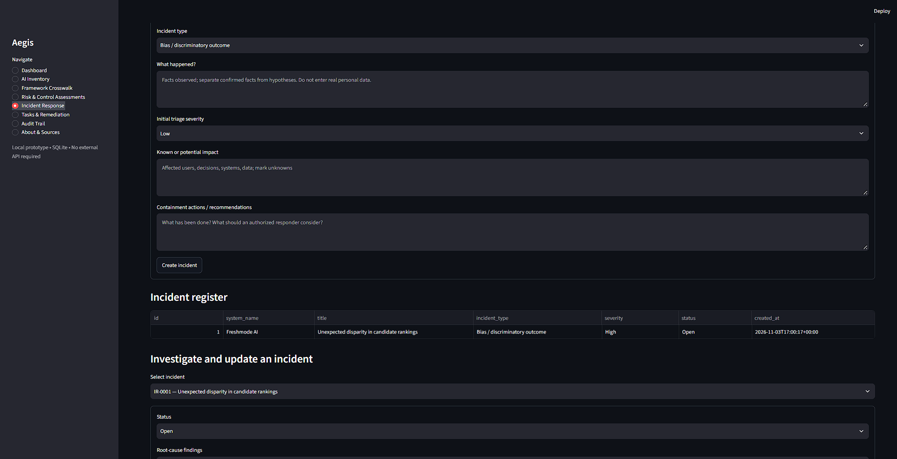

# Aegis AI Governance

### A Framework-Aware AI Risk & Incident Response Platform

Aegis is an  AI governance platform designed to help organizations assess AI risks, map governance controls, document incidents, and track remediation using the **EU AI Act** and **NIST AI Risk Management Framework (AI RMF)**.

Rather than treating AI governance as a collection of policies, Aegis demonstrates how governance frameworks can be translated into practical risk assessments, evidence records, and incident response workflows.



##  Project Objective

AI systems can introduce risks such as algorithmic bias, data leakage, prompt injection, model drift, and unauthorized access.

Aegis provides a centralized interface to:

- Maintain an inventory of AI systems.
- Map governance requirements to practical controls.
- Record risk and control assessments.
- Manage AI-related incidents.
- Assign remediation tasks and track corrective actions.
- Maintain an application activity log.
- Export assessment and incident records.

##  Application Screenshots

### Governance Dashboard

Provides an overview of registered AI systems, open incidents, failed control assessments, and remediation tasks.


### AI System Inventory

Register AI systems, document their intended purpose, identify data types, and record preliminary risk classifications.



### Framework Crosswalk

Explore the relationship between selected EU AI Act provisions and NIST AI RMF functions.



### Incident Response

Document incidents, assess potential impacts, record containment actions, investigate root causes, and create remediation tasks.



##  Frameworks Used

### EU AI Act

Aegis includes selected reference points from Regulation (EU) 2024/1689:

| Provision | Governance focus |
|---|---|
| Article 9 | Risk management |
| Article 10 | Data governance |
| Article 11 | Technical documentation |
| Article 12 | Record-keeping |
| Article 14 | Human oversight |
| Article 15 | Accuracy, robustness, cybersecurity |
| Article 72 | Post-market monitoring |
| Article 73 | Serious-incident reporting |

### NIST AI RMF 1.0

The application incorporates the four core functions:

- **GOVERN:** Policies, accountability, roles, and oversight.
- **MAP:** Intended purpose, context, stakeholders, and impacts.
- **MEASURE:** Risk evaluation, testing, and monitoring.
- **MANAGE:** Risk prioritization, treatment, and remediation.

The framework crosswalk is a working reference mapping, not a determination of legal compliance or equivalence.

##  Incident Response Demonstration

Aegis includes a simulated AI recruitment incident.

**Scenario:** An AI recruitment system produces unexpectedly lower candidate rankings for a demographic group.

The incident response workflow includes:

1. Incident identification and initial severity assessment.
2. Documentation of potential impact.
3. Evidence preservation and investigation.
4. Containment recommendations.
5. Root-cause analysis.
6. Remediation task assignment.
7. Corrective-action verification.
8. Incident closure and audit trail.

The demonstration highlights how NIST AI RMF MEASURE and MANAGE activities can support an incident response process, alongside assessment of relevant EU AI Act obligations.

## Technology Stack

| Technology | Purpose |
|---|---|
| Python | Application logic |
| Streamlit | Interactive web interface |
| SQLite | Local data persistence |
| Pandas | Data handling and CSV exports |
| Git & GitHub | Version control |

##  Getting Started

### Prerequisites

- Python 3.11 or later
- Git
- A terminal or VS Code

### Installation

Clone the repository:

```bash
git clone https://github.com/YOUR_USERNAME/aegis-ai-governance.git
cd aegis-ai-governance
```

Create a virtual environment:

```bash
python -m venv .venv
```

Activate it on Windows:

```powershell
.\.venv\Scripts\Activate.ps1
```

Install dependencies:

```bash
python -m pip install -r requirements.txt
```

Launch the application:

```bash
python -m streamlit run app.py
```

Open the local URL provided by Streamlit, typically:

```text
http://localhost:8501
```

## Key Features

- AI system inventory and preliminary risk classification.
- EU AI Act and NIST AI RMF reference crosswalk.
- Evidence-based control assessment register.
- AI incident tracking and response checklists.
- Remediation task assignment and status tracking.
- Application activity log.
- CSV exports and downloadable incident reports.

##  Limitations

Aegis is an educational prototype and decision-support tool.

- It does not automatically establish legal compliance.
- AI Act applicability and high-risk classification require case-specific review.
- Incident reportability requires qualified assessment.
- Crosswalks require expert review before operational use.
- The local SQLite database and activity log are not production-hardened.
- Do not enter real personal, confidential, or regulated data.

##  Official References

- [EU AI Act — Regulation (EU) 2024/1689](https://eur-lex.europa.eu/eli/reg/2024/1689/oj)
- [European Commission AI Act Service Desk](https://ai-act-service-desk.ec.europa.eu/en/ai-act-explorer)
- [NIST AI Risk Management Framework](https://www.nist.gov/itl/ai-risk-management-framework)
- [NIST AI RMF Playbook](https://www.nist.gov/itl/ai-risk-management-framework/nist-ai-rmf-playbook)

